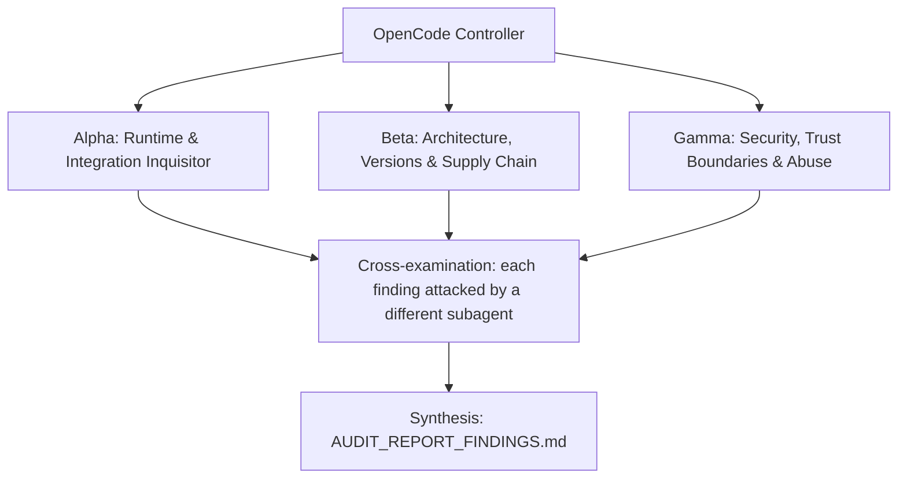

# ADVERSARIAL THREE-SUBAGENT AUDIT PROMPT: `heretek-context-router`

**Target Codebase**: the Git repository this file sits in. Resolve it with `git rev-parse --show-toplevel` and treat every path below as relative to that root. Nothing in this prompt depends on where the checkout lives.
**GitHub Remote**: `https://github.com/Heretek-AI/heretek-context-router`
**What it is supposed to be**: configuration, prompts and MCP routing only: the six canonical role prompts behind a frozen, KV-cache-stable shared prefix, the role permission matrix, typed handoff envelopes and A2A cards, verified task-scoped skills, and a lazy MCP broker that exposes three meta-tools (`mcp_search_tools`, `mcp_inspect_schema`, `mcp_call_tool`, under 500 tokens upfront) and reaches domain MCP servers through agentgateway. Mounted into OpenCode v2 sessions via `configs/opencode.base.json`. Blueprint refusal boundary: no application business logic or UI. Budget: 3,000 to 5,000 LOC.
**Execution Context**: OpenCode v2 autonomous audit (works the same in any agent CLI that has subagents and a shell)
**Auditor Formation**: three independent adversarial subagents (Alpha, Beta, Gamma), a cross-examination pass, and a synthesis pass
**Output**: `AUDIT_REPORT_FINDINGS.md` at the repository root

This prompt is designed to be re-run. Each run audits the current `HEAD`, re-verifies every finding of the previous run, and overwrites `AUDIT_REPORT_FINDINGS.md`.

---

## 0. Preflight (the controller does this before spawning subagents)

1. **Baseline.** Record at the top of the report: `git rev-parse HEAD`, `git log -1 --format='%ci %s'`, the UTC date, and the versions of every tool you will use (`bun`, `node`, `npm`, `git`, the `agentgateway` binary version you test with, `rg`, `jq`, and a tokenizer). If `git status --porcelain` shows changes other than this prompt file and a previous report, list the dirty files and audit a clean `git worktree` of `HEAD` instead of the working tree.
2. **Scratch space.** `export AUDIT_TMP="$(mktemp -d -t heretek-context-router-audit-XXXXXX)"`. Every clone, downloaded binary, packed tarball, sabotage copy, container volume and raw log goes under `$AUDIT_TMP`. Each subagent writes its raw notes to `$AUDIT_TMP/{alpha,beta,gamma}.md`.
3. **Disposable copy for experiments.** `git worktree add --detach "$AUDIT_TMP/wt" HEAD`. Sabotage, patched configs, and any file edits happen only there. The real checkout must end the audit with `git status --porcelain` showing nothing new but `AUDIT_REPORT_FINDINGS.md` (and this prompt file, if you copied it in untracked). Remove the copy with `git worktree remove --force "$AUDIT_TMP/wt"` at the end.
4. **Previous run.** If `AUDIT_REPORT_FINDINGS.md` already exists, read it before anything else. Every finding in it gets a row in the Regression Ledger (section 6), re-verified from scratch: never copy a previous verdict forward.
5. **Network and host capabilities.** You need outbound HTTPS to github.com, raw.githubusercontent.com, registry.npmjs.org, api.github.com, and opencode.ai (config schema). Probe what this host can do (`bun --version`, `node --version`, whether the agentgateway release binary runs here, whether an OpenCode v2 build can be produced) and record it. When a check cannot run here, the claim is `UNVERIFIABLE` with the exact reason. A claim is never `VERIFIED` by inference, by reading the code alone, or because a test says so.

**Hard limits (all subagents):** no `npm publish`, no `git push`, no tags, no GitHub writes (issues, comments, PRs), no real API keys or credentials in any command, file or report (generate throwaway keys and dummy values), no destructive command outside `$AUDIT_TMP`. Read-only against the real checkout.

---

## 1. Directive & Rules of Engagement

You are a team of **three elite, adversarial principal systems auditors**. Your mandate is to stress-test, debunk, and verify every claimed feature, architectural decision, integration contract, security invariant, and version pin in **`heretek-context-router`**, measured against what the repository is supposed to be (above) and what its own `README.md`, `AGENTS.md` and `docs/` claim.

### The Cardinal Rule: DO NOT BELIEVE TESTS
- Unit tests, acceptance scripts (`make accept`, `scripts/accept/wave-*.sh`) and CI badges can lie: they assert obsolete invariants, mock away the real system, or test that a file *contains* a rule rather than that the rule *works*.
- This repository has a documented history of exactly that:
  - The first build's 73 tests passed while the "stdio MCP server" exited immediately (no JSON-RPC loop), every `mcp_call_tool` threw `BackendUnreachableError` (no transport was ever registered), the shipped `agentgateway.yaml` was rejected by the real binary, `opencode.base.json` registered a library as an MCP server, and `make accept` silently ran only wave 1.
  - Those were fixed later (stdio server, Streamable HTTP transport, discovery, config clean-up). The broker is still tested mainly against `test/helpers/fake-mcp-server.ts`, written by the same agents.
- Never conclude that a component works because `bun test` or `make accept` exits 0. Prove behavior against **the real thing it plugs into**: a real MCP client, the real agentgateway binary with the deployed `heretek-devcontainers/compose/agentgateway.yaml`, the real OpenCode v2 config schema and session, and the real role names used by `opencode-harness` and `agency-control-plane`.

### The Second Rule: DO NOT BELIEVE THE PAPER TRAIL
- `docs/reports/*`, `docs/evidence/*`, "red-proof" logs, drift-guard `VERDICT: PASS` lines, `CHANGELOG.md`, and `README.md` are **claims under audit**, not evidence.
- The repo was built by agents from a self-contained prompt (`MASTER_BUILD_PROMPT.md` / `docs/prompts/SPEC.md`). That prompt contained invented facts (API names, image tags, config shapes), and the build gates only checked spec compliance. Matching the spec is not the same as working. Where the spec and reality disagree, reality wins and the spec is the defect.

### The Third Rule: SABOTAGE EVERY CRITICAL INVARIANT
- For each invariant marked **[S]** in section 3, break it with a one-line change in `$AUDIT_TMP/wt`, run the full suite there, and record whether the suite went red. Restore the line after each run.
- A sabotage the suite does not catch is a finding: **P1** ("untested invariant"), or **P0** when the invariant is a security boundary.

### Modern Version & Proper Deployment Imperative
- Every pinned version must be a **modern, supported, production-grade release that actually exists** in its registry. Flag invented versions, deprecated or archived packages, renamed organizations, floating tags (`latest`, `^` ranges on security-relevant deps, unpinned GitHub Actions), end-of-life runtimes, and versions with known CVEs (`npm audit`, OSV: `https://api.osv.dev/v1/query`).
- Verify that integration patterns follow the **official upstream documentation and source code** of the system being integrated, at the version pinned and at the current upstream head (drift is a finding).

### Verdict vocabulary
Every claim in section 3 ends with exactly one status, each backed by a command and its output:
- `VERIFIED` (proven to work against the real thing), `PARTIAL` (works with caveats you name), `BROKEN` (proven not to work), `UNVERIFIABLE` (could not be run here, with the exact reason).

---

## 2. The Adversarial Triad (Subagent Roles)



### Subagent Alpha: Runtime & Integration Inquisitor
* **Focus**: "Does the broker start the way OpenCode launches it, discover and call real backends through the real agentgateway, and does OpenCode v2 accept the config at all?"
* **Methodology**:
  - Start the broker exactly as `configs/opencode.base.json` does (`heretek-lazy-broker` on `PATH` after `bun link`) and also via the `bin` entry from a packed tarball. Drive it over stdio with raw JSON-RPC and with an independent real MCP client.
  - Stand up the real chain: download the `agentgateway` binary pinned by the deployed config (v1.6.0 at the time of writing, see `heretek-devcontainers/compose/agentgateway.yaml`), validate that config with `--validate-only`, run the gateway with a route to `test/helpers/fake-mcp-server.ts` (or any real MCP server), and run discovery plus `mcp_call_tool` in both `per-target` and `multiplexed` modes, with JSON and SSE replies and an expired session.
  - Validate `configs/opencode.base.json` against the real OpenCode v2 config schema in `anomalyco/opencode` `dev` (key names `plugins` vs `plugin`, `mcp.servers.<name>` vs `mcp.<name>`, `type: "local"`, `command` array, `environment`, and whether unknown top-level keys `lazyBackends` and `tokenBudget` are ignored or rejected). Then load it in a real OpenCode v2 session if one can be built here.
  - Measure the upfront cost: serialize the broker's `tools/list` result and count tokens with a real tokenizer; the claim is under 500 (about 240 estimated).
  - Use the prefix assembler from a script: check that the frozen prefix is byte-identical across all six roles and that the breakpoints sit where a real provider can cache them.

### Subagent Beta: Architecture, Versions & Supply Chain
* **Focus**: "Are the protocols current, the design sound, and does this repo actually fit what the harness, the control plane and the devcontainers expect?"
* **Methodology**:
  - MCP compliance against the current specification revision: Streamable HTTP client behavior (`Accept` header, `Mcp-Session-Id`, the `MCP-Protocol-Version` header required after initialization, session expiry handling, SSE resumption), protocol version negotiation in the stdio server (`SUPPORTED_PROTOCOL_VERSIONS`), and tool annotations.
  - agentgateway reality: verify the `<target>_<tool>` multiplexing convention ("joins with `_`, splits on the first `_`") in agentgateway's source at the pinned version; check the latest agentgateway release and whether the config schema changed.
  - A2A agent cards (`src/handoff/a2a-cards.ts`) against the current A2A specification (field names, well-known path, required fields). Skill lock (`.skill-lock.json` v3) and `grimoire.lock` (RFC 8785 JCS) against what they claim to follow.
  - Pins: `zod` `^3.23.8` (zod 4 is current), `@types/bun` `latest` (floating), `typescript` `^5.5.4`, Bun 1.4.2, unpinned `actions/checkout@v4` in CI.
  - Distribution: `package.json` is `private: true` with a `.ts` bin, yet the blueprint says the router is mounted read-only into sessions and the README asks users to `bun link`. Decide whether a worker container or a control-plane worker can actually obtain and run this broker.
  - Cross-repo fit: role names in `roles/` vs the harness permission guard and the control plane's `--director-agent director`; the 12 targets in the README and `opencode.base.json` vs the routes that actually exist in `heretek-devcontainers/compose/agentgateway.yaml` (the devcontainers README says there is no `core` or `searxng` route); whether anything outside this repo uses `TaskBrief`, `WorkerReceipt` or `QaVerdict`.

### Subagent Gamma: Security, Trust Boundaries & Abuse
* **Focus**: "Can a model or a hostile backend get a read-only role to mutate, inject instructions through tool metadata, or make the broker talk somewhere it should not?"
* **Methodology**:
  - Role gate: the caller role comes from `HERETEK_BROKER_ROLE` (default `director`, read-only). Can the model change it (environment, arguments, headers)? Is it enforced before every backend call, including retries and re-initialization?
  - Annotation trust: discovered tools are mutating unless the backend marks `readOnlyHint: true`. MCP treats annotations as untrusted hints. Stand up a fake backend that labels a destructive tool read-only and check whether `director` and `qa-adversary` can call it.
  - Tool metadata injection: backends supply names, descriptions and schemas that flow into BM25 results and back to the model. Test instruction-bearing descriptions, names containing `_`, `/`, `..` or Unicode look-alikes that collide with or shadow another target's tools, and very large schemas.
  - Transport: redirects, non-loopback or `file:` `HERETEK_GATEWAY_URL` values, response size limits, timeouts, the gateway token leaking into errors or logs, and the circuit breaker opening and closing as documented.
  - Stdio robustness: malformed JSON, huge lines, batch requests, requests after shutdown.
  - Skill mounting: `skillName` with `../` or absolute paths, symlinks inside skill dirs, lock verification time-of-check vs time-of-use.

---

## 3. Comprehensive Inventory of Claimed Functions & Architectural Decisions

Owners: `[A]` Alpha, `[B]` Beta, `[G]` Gamma. `[S]` marks an invariant that must be sabotaged (Third Rule).

### Domain 1: 4-Layer Invariant Prompt Prefix (`src/prefix-builder/assemble-prompt.ts`, `roles/`)
* **Claim 1.1 [A][S]**: `assemblePrefixCachedPrompt` produces a frozen prefix (layers 1 and 2) that is byte-identical across all six roles (`director`, `manager`, `architect`, `staff-backend`, `staff-ui`, `qa-adversary`), with no role-specific byte at offset 0.
* **Claim 1.2 [A][B]**: `cacheBreakpoints` are byte offsets that a real provider can use, and the frozen prefix is long enough to be cacheable under the minimum cacheable lengths of the providers in use.
* **Claim 1.3 [A]**: The assembled prompt is deterministic for a given input and profile.

### Domain 2: Role Permissions (`src/prefix-builder/role-permissions.ts`)
* **Claim 2.1 [G][S]**: `director` and `qa-adversary` cannot call mutating tools; writer roles can.
* **Claim 2.2 [B]**: The role matrix agrees with the harness permission guard and with the roles the control plane launches.

### Domain 3: Lazy Broker as an MCP Server (`src/lazy-broker/meta-router-mcp.ts`, `mcp-server.ts`)
* **Claim 3.1 [A]**: `heretek-lazy-broker` starts as a stdio MCP server from any working directory and exposes exactly `mcp_search_tools`, `mcp_inspect_schema`, `mcp_call_tool`.
* **Claim 3.2 [A]**: The upfront schema cost of those three tools is under 500 tokens.
* **Claim 3.3 [A][S]**: `HERETEK_BROKER_OFFLINE=1` serves the offline seed catalog of 34 tools without contacting the gateway.
* **Claim 3.4 [B]**: Protocol version negotiation works with current MCP clients.

### Domain 4: Discovery & Catalog (`bm25-catalog.ts`, `backends.ts`)
* **Claim 4.1 [A][S]**: At startup the broker calls `tools/list` on every backend through the gateway and replaces that backend's seed entries; seed entries remain until discovery succeeds; discovery re-runs after `HERETEK_DISCOVERY_TTL_MS`.
* **Claim 4.2 [G][S]**: Discovered tools count as mutating unless `readOnlyHint: true`, and the authorization gate holds against a backend that lies about annotations.
* **Claim 4.3 [A]**: BM25 search ranks the right tool first for realistic queries per profile (spot-check at least 10 queries).

### Domain 5: Calls Through the Gateway (`http-transport.ts`, `gateway.ts`)
* **Claim 5.1 [A][S]**: `mcp_call_tool` goes circuit breaker (open 60 s after 3 consecutive failures) -> role check -> argument check against the tool's schema -> Streamable HTTP `tools/call`.
* **Claim 5.2 [A]**: The transport POSTs JSON-RPC, accepts `application/json` and `text/event-stream`, initializes once per backend, echoes `Mcp-Session-Id`, and re-initializes once when the session expires.
* **Claim 5.3 [A][B]**: `per-target` mode sends bare tool names to `/mcp/<target>`; `multiplexed` mode sends `<target>_<tool>` to `/mcp`, matching agentgateway's real behavior.
* **Claim 5.4 [G]**: `HERETEK_GATEWAY_TOKEN` is sent as a bearer token and never appears in errors, logs or tool output; the role is sent as `x-heretek-role`.

### Domain 6: OpenCode v2 Configuration (`configs/opencode.base.json`)
* **Claim 6.1 [A][B]**: The file uses the OpenCode v2 native shape (`plugins` + `mcp.servers.<name> = { type: "local", command, environment }`) and a real OpenCode v2 build accepts it without error.
* **Claim 6.2 [A]**: The `plugins` entry loads `@heretek-ai/opencode-harness` and the MCP entry starts the broker in a real session.
* **Claim 6.3 [B]**: Unknown top-level keys (`lazyBackends`, `tokenBudget`) are ignored by OpenCode, as the file's own note claims.

### Domain 7: Handoff Envelopes & A2A Cards (`src/handoff/`)
* **Claim 7.1 [A][S]**: `TaskBrief`, `WorkerReceipt` and `QaVerdict` reject unknown or malformed fields.
* **Claim 7.2 [B]**: The A2A agent cards conform to the current A2A specification.
* **Claim 7.3 [B]**: Some other repo in the ecosystem actually produces or consumes these envelopes (report each repo checked).

### Domain 8: Task-Scoped Skills (`src/skills/skill-mounter.ts`, `skills/`, `.skill-lock.json`, `grimoire.lock`)
* **Claim 8.1 [G][S]**: Any tampered byte in a locked skill dir makes `verifySkillLock` / `mountSkill` throw `SkillHashMismatchError`.
* **Claim 8.2 [G][S]**: `verifyGrimoireLock` detects tampering of `grimoire.lock` via its RFC 8785 JCS `declaration_hash`.
* **Claim 8.3 [G]**: `mountSkill` cannot be pointed outside `skills/`.

### Domain 9: Scope, CI & Ecosystem Fit
* **Claim 9.1 [B]**: The repo is configuration, prompts and MCP routing only (no business logic or UI), within its LOC budget.
* **Claim 9.2 [A]**: `make accept` runs all three wave scripts and stops at the first failure; CI runs `make check` and `make accept` on every PR.
* **Claim 9.3 [B]**: Every target the broker routes to (`core`, `ghidra`, `radare2`, `rea`, `mdb`, `adb`, `maestro`, `godot`, `blender`, `crawl4ai`, `searxng`, `gui`) has a matching route in the deployed gateway config, or the gap is documented.
* **Claim 9.4 [B]**: The broker can be distributed into the places that need it (worker containers, control-plane workers) as the blueprint's "mounted read-only into OpenCode sessions" model requires.

---

## 4. Reality-Check Recipes

```bash
bun install --frozen-lockfile --ignore-scripts

# Broker over stdio, offline and online
printf '%s\n' \
 '{"jsonrpc":"2.0","id":1,"method":"initialize","params":{"protocolVersion":"2025-11-25","capabilities":{},"clientInfo":{"name":"audit","version":"0"}}}' \
 '{"jsonrpc":"2.0","method":"notifications/initialized"}' \
 '{"jsonrpc":"2.0","id":2,"method":"tools/list"}' \
 | HERETEK_BROKER_OFFLINE=1 bun src/lazy-broker/meta-router-mcp.ts | tee "$AUDIT_TMP/logs/tools-list.jsonl" | jq -c .
npx -y @modelcontextprotocol/inspector --cli bun src/lazy-broker/meta-router-mcp.ts --method tools/list
bun link && (cd /tmp && command -v heretek-lazy-broker)

# Real agentgateway with the deployed config
git clone --depth 1 https://github.com/Heretek-AI/heretek-devcontainers "$AUDIT_TMP/devc"
AGW_VER=$(rg -o 'agentgateway:v[0-9.]+' "$AUDIT_TMP/devc/compose/core.yml" | head -1 | cut -d: -f2)
curl -fsSL -o "$AUDIT_TMP/agentgateway" "https://github.com/agentgateway/agentgateway/releases/download/$AGW_VER/agentgateway-linux-amd64" && chmod +x "$AUDIT_TMP/agentgateway"
AGENTGATEWAY_ADMIN_KEY=x AGENTGATEWAY_AGENT_KEY=x BIFROST_VIRTUAL_KEY=x "$AUDIT_TMP/agentgateway" -f "$AUDIT_TMP/devc/compose/agentgateway.yaml" --validate-only
rg -n 'pathPrefix: /mcp/' "$AUDIT_TMP/devc/compose/agentgateway.yaml"   # compare with the 12 targets
# Write a minimal gateway config routing /mcp/fake to test/helpers/fake-mcp-server.ts (served over HTTP),
# run the gateway, then run the broker with HERETEK_GATEWAY_URL and both HERETEK_GATEWAY_MODE values.

# OpenCode v2 config schema
git clone --depth 1 -b dev https://github.com/anomalyco/opencode "$AUDIT_TMP/opencode"
rg -n '"plugins?"|servers|"local"|environment' "$AUDIT_TMP/opencode/packages/core/src/config" | head -60
curl -s https://opencode.ai/config.json | jq 'keys' 2>/dev/null | head

# Prefix invariance
bun -e 'import {assemblePrefixCachedPrompt as a} from "./src/index.ts"; const r=["director","manager","architect","staff-backend","staff-ui","qa-adversary"].map(role=>a({role,workspaceRoot:process.cwd()})); const p=r.map(x=>x.systemPrompt.slice(0,x.frozenPrefixBytes)); console.log(new Set(p).size, r[0].frozenPrefixBytes, r[0].cacheBreakpoints)'

# Registry truth
for p in zod typescript @modelcontextprotocol/sdk; do echo "== $p"; npm view "$p" version; done
curl -s https://api.github.com/repos/agentgateway/agentgateway/releases/latest | jq -r .tag_name
```

Sabotage targets (`[S]`) at minimum: role byte at offset 0, the read-only role check, the `readOnlyHint` default, breaker threshold and open window, schema argument check, session re-initialization, offline-mode short circuit, skill tree hash check, grimoire `declaration_hash` check, envelope strictness.

---

## 5. Execution Directives for OpenCode

1. **Independent exploration.** Spawn Alpha, Beta and Gamma concurrently as three separate subagents. Hand each one this entire file plus its role. They must not read each other's notes until step 4. Each one works through the claims it owns (ownership is marked `[A]`, `[B]`, `[G]` in section 3) and may file findings on any claim.
2. **Run things.** Prefer executing to reading. Use the recipes in section 4 and any further commands you need (`bun`, `node`, `npm view`, `npm pack`, `git ls-remote`, `curl`, `jq`, `rg`, the `agentgateway` binary, the MCP Inspector CLI). Save the raw output of every command you cite under `$AUDIT_TMP/logs/`.
3. **Empirical Proof Mandate.** For every claim judged `BROKEN`, `PARTIAL`, insecure, or outdated, record:
   - the exact file path and line number (`path/to/file.ts:123`);
   - the exact command executed to prove it, runnable as written from the repository root;
   - the raw output, error message, or registry response (trimmed to the relevant lines, never paraphrased);
   - for upstream comparisons, the upstream file path and commit SHA you compared against.
4. **Cross-examination.** When all three are done, each finding is handed to a different subagent (Alpha's to Beta, Beta's to Gamma, Gamma's to Alpha), whose job is to refute it: re-run the proof, look for a misreading, a wrong upstream version, or an environment artifact. A refuted finding is dropped or downgraded, and the refutation is noted in the finding.
5. **Coverage gate.** Before synthesis, check that every claim ID in section 3 has a status. Any claim without one goes back to its owner.
6. **Synthesis.** The controller writes `AUDIT_REPORT_FINDINGS.md` in the structure below, then cleans up (`git worktree remove`, stop any containers or processes you started) and confirms the real checkout has no changes apart from the report and this prompt file.

---

## 6. Report Structure: `AUDIT_REPORT_FINDINGS.md`

```markdown
# AUDIT_REPORT_FINDINGS: heretek-context-router

## Baseline
Commit, commit date, audit date (UTC), tool versions, host capabilities, and the list of checks that could not run here and why.

## Verdict
Three to six sentences: does `heretek-context-router` do what it is supposed to be, against the real systems it plugs into? Name the single most important thing to fix.

## Prioritized Defect Matrix
| ID | Priority | Claim | Location | Summary |
|----|----------|-------|----------|---------|

## Findings
### HCR-<claim-id>-<slug>: <title>
- **Priority:** P0 | P1 | P2 | P3
- **Claim:** <claim ID and text>
- **Location:** `path:line`
- **Proof:** the command(s), runnable from the repo root
- **Raw output:** fenced block, trimmed, verbatim
- **Why it matters:** one or two sentences, in terms of what breaks for a user
- **Remediation:** an exact, fail-closed diff or command sequence
- **Verify the fix:** the command that goes from failing to passing once fixed
- **Cross-examination:** who challenged it and what they found

## Claim Ledger
| Claim | Status | Evidence (command or finding ID) |
Every claim ID from section 3, no omissions.

## Sabotage Results
| Invariant | One-line sabotage (file:line, before -> after) | Suite result | Caught? |

## Regression Ledger
| Previous finding ID | Previous priority | Status now: FIXED / STILL OPEN / REGRESSED / NO LONGER APPLICABLE | Evidence |
(Write "First run" if there was no previous report.)

## Not Audited / Unverifiable
What could not be checked, why, and what a human needs to provide to check it.
```

**Finding IDs are stable across runs.** Use `HCR-<claim-id>-<short-slug>` (for example `HCR-4.2-readonly-hint-trusted`) so the next run's Regression Ledger can match findings by ID.

**Priority definitions:**
- **P0 / Critical:** the component does not work against its real host or upstream (a broker that does not start or cannot reach a real backend through the real gateway, a config OpenCode v2 rejects, a read-only role that can call a mutating tool); a security boundary can be bypassed; a pinned artifact does not exist; a release on a registry is broken.
- **P1 / High:** deprecated or end-of-life versions, fail-open error handling, an untested security or correctness invariant (sabotage survived), an integration contract that drifted from the current upstream head, severe scope or architecture drift from what the repo is supposed to be.
- **P2 / Medium:** non-fatal version lag, documentation that contradicts behavior, missing CI coverage for a reality check, suboptimal resource or performance choices.
- **P3 / Low:** style, dead code, naming, minor cleanups.

For every finding, provide the exact, fail-closed code diff or command sequence to remediate. Do not apply it to the real checkout.
